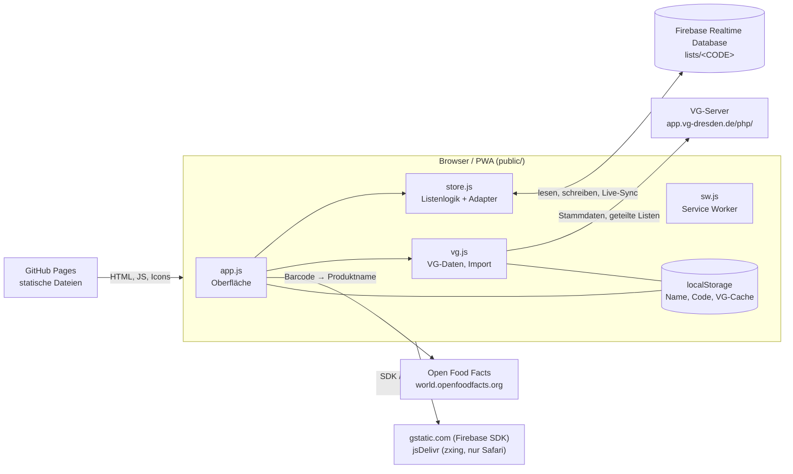

# Architektur

Stand: Beschreibung des Codes in `public/`, `database.rules.json`, `.github/workflows/pages.yml` und `test/`. Was sich aus dem Code nicht sicher ableiten lässt, ist mit **(unsicher)** markiert.

## Überblick

vg-korbjagd ist eine statische Seite ohne eigenen Server und ohne Build-Schritt: ES-Module, die der Browser direkt lädt. Der gemeinsame Zustand liegt in der Firebase Realtime Database; alle Geräte abonnieren dieselbe Liste und sehen Änderungen sofort.



Alle Aufrufe an VG-Server, Open Food Facts und Firebase gehen direkt aus dem Browser. Die VG-Endpunkte erlauben das per CORS (siehe [vg-api.md](vg-api.md)). Das Projekt ist von der VG Dresden unabhängig.

Dateien in `public/`:

| Datei | Aufgabe |
|---|---|
| `index.html` | Gerüst und Styles, alle Ansichten (Willkommen, Liste, Leergut, Kasse, Rangliste) und Dialoge (Teilen, Import, Scanner) |
| `app.js` | Oberfläche, Ereignisse, Scanner, Import-Dialog, Teilen |
| `store.js` | Datenschicht: Adapter (Firebase/lokal) und Listenlogik |
| `vg.js` | VG-Stammdaten laden und zwischenspeichern, Teilen-Links der Original-App entschlüsseln |
| `firebase-config.js` | Firebase-Webkonfiguration (öffentliche Kennungen); `null` = Demo-Modus |
| `sw.js`, `manifest.json`, `icon.svg` | PWA: Service Worker, Manifest, Icon |
| `vendor/qrcode.js`, `vendor/crypto-js.js` | eingebundene Fremdbibliotheken (QR-Code, AES) |

## Datenmodell in Firebase

Alles liegt unter `lists/<CODE>`. Der Code besteht aus 6 Zeichen aus `ABCDEFGHJKLMNPQRSTUVWXYZ23456789` (ohne I, O, 0, 1). `create()` würfelt so lange, bis `meta` noch nicht existiert.

```json
{
  "lists": {
    "K7M2QX": {
      "meta": { "created": 1761900000000 },
      "items": {
        "k3j9x2ab": {
          "id": "k3j9x2ab",
          "title": "Vollmilchschokolade",
          "amount": 2,
          "unit": null,
          "info": null,
          "vgNum": 1234,
          "ean": null,
          "checked": true,
          "checkedBy": "🦊 Mia",
          "checkedAt": 1761900300000,
          "addedBy": "🐼 Paul",
          "addedAt": 1761900100000
        }
      },
      "scores": { "🦊 Mia": 3, "🐼 Paul": 0 },
      "deposit": {
        "7": { "🦊 Mia": 2, "🐼 Paul": 1 }
      }
    }
  }
}
```

(Beispielwerte erfunden.) Erläuterung:

- **Nutzerschlüssel:** `"<Emoji> <Name>"`, Zeichen `. $ # [ ] /` werden durch `_` ersetzt (`userKey`), weil Firebase sie in Schlüsseln verbietet. Es gibt keine Anmeldung: Wer denselben Emoji-Namen wählt, ist für die App dieselbe Person.
- **`items/<id>`:** `id` wird im Browser gewürfelt. Titel max. 120 Zeichen, `amount` 1–999, `unit` max. 20, `info` max. 200, `ean` nur 8–14 Ziffern, sonst `null`. Nicht abgehakt: `checked: false`, `checkedBy`/`checkedAt` `null`.
- **`scores/<Nutzerschlüssel>`:** Punktestand, nie unter 0. Eintrag wird beim Beitritt mit 0 angelegt (`join`).
- **`deposit/<Pfand-Typ-ID>/<Nutzerschlüssel>`:** Anzahl Leergut-Stücke, die diese Person eingetragen hat. Die Typ-ID (`id` aus `getDepositsList.php`) ist hier als Zeichenkette Schlüssel; die Namen der Typen kommen nicht aus Firebase, sondern aus den VG-Daten.
- **Regeln** (`database.rules.json`): Außerhalb von `lists/<CODE>` ist alles gesperrt; unter `lists/$code` sind Lesen und Schreiben offen, `$code` muss auf `^[A-Z0-9]{6}$` passen. Die Liste ist also nur über ihren Code erreichbar, wer ihn kennt, darf alles. Eine Prüfung der Feldinhalte gibt es in den Regeln nicht, die Begrenzungen oben passieren nur im Client. Sicherheitsfragen: siehe `docs/security.md`, falls vorhanden (nicht Teil dieser Beschreibung).

## `store.js`

### Adapter

Die Listenlogik (`createStore`) ist einmal geschrieben und läuft gegen einen Adapter mit fünf Funktionen: `subscribe`, `get`, `update` (Transaktion), `set`, `remove`.

- **`firebaseAdapter(cfg)`** lädt das Firebase-SDK (Version 10.14.1) zur Laufzeit von `gstatic.com`. `subscribe` meldet den Listenstand und über `.info/connected` den Verbindungsstatus (grüner/roter Punkt in der Kopfzeile). `update` ist `runTransaction`.
- **`localAdapter(storage)`** speichert alles als JSON in `localStorage` (Schlüssel `korbjagd-local-db`) und benachrichtigt andere Tabs über das `storage`-Ereignis. Er wird benutzt, wenn `firebase-config.js` `null` exportiert (Demo-Modus mit Hinweisbanner), und in den Tests mit eigenem Storage-Objekt. Leere Knoten werden wie bei Firebase entfernt.

`update(code, path, fn)`: `fn` bekommt den alten Wert; Rückgabe `undefined` bricht ab (`committed: false`), `null` löscht, sonst wird der Wert geschrieben. Mehrere Geräte, die gleichzeitig dasselbe tun, erzeugen so nur eine Änderung.

### Punktelogik

Punkte werden in `scores` mitgeführt und bei jeder Aktion über `bump` angepasst (`Math.max(0, alt + Änderung)`, ebenfalls als Transaktion). Der Zähler wird nur erhöht, wenn die Haupt-Transaktion tatsächlich etwas geändert hat (`committed`). Deshalb gibt doppeltes Abhaken nur einen Punkt.

| Aktion | Wirkung auf Punkte |
|---|---|
| `add` | keine (gibt es schon eine Artikel-`id`, passiert nichts) |
| `check(…, true)` | +1 für den Abhaker |
| `check(…, false)` | −1 für den **ursprünglichen** Abhaker (`checkedBy`), nicht für den, der zurücknimmt |
| `setNum(…, checkToo)` | VG-Nummer nachtragen; wird der Artikel dadurch erstmals abgehakt, +1 für den Eintragenden. Der Titel wird nur ersetzt, wenn er noch der Platzhalter `VG-Nr. <Zahl>` ist |
| `remove` | war der Artikel abgehakt, −1 für den ursprünglichen Abhaker |
| `depositAdd` | +1 Stück für den Eintragenden, +1 Punkt |
| `depositRemove` | zieht erst ein eigenes Stück ab, hat die Person keins, eins vom größten Beitragenden; der Punkt geht bei dem ab, dessen Stück entfernt wurde |
| `clearChecked` (Erledigte entfernen) | löscht abgehakte Artikel **ohne** Punktänderung |
| `clearDeposit` (Leergut leeren) | löscht `deposit`, Punkte bleiben |
| `resetScores` (Neue Runde) | berechnet `scores` neu: alle bekannten Nutzer auf 0, dann +1 pro **noch vorhandenem** abgehaktem Artikel und +Stückzahl pro **noch vorhandenem** Leergut |

Das heißt: „Neue Runde“ setzt nur dann alles auf null, wenn vorher Erledigte entfernt und Leergut geleert wurden. Sonst zählen die noch vorhandenen Einträge wieder mit. (Aus dem Code abgeleitet, nicht von Hand ausprobiert.)

### Gleichstand

Die Rangliste (`render` in `app.js`) sortiert nach Punkten absteigend. Der Platz ist `1 + Index des ersten Eintrags mit gleicher Punktzahl`, also 1, 1, 3, … bei Gleichstand. Medaillen 🥇🥈🥉 gibt es nur für Plätze 1–3 und nur mit mehr als 0 Punkten; das Podest zeigt Platz 2, 1, 3 in dieser Reihenfolge, auch mehrere Personen pro Platz.

## `vg.js`

- **Quelle:** `https://app.vg-dresden.de/php/`, Endpunkte siehe [vg-api.md](vg-api.md). Jede Anfrage hat 20 s Zeitlimit.
- **Cache mit Prüfsummen (`loadVg`):** Zuerst `getChecksums.php`. Stimmen die Prüfsummen mit dem Cache (`localStorage`, Schlüssel `korbjagd-vg-v2`) überein oder ist das Netz weg, wird der Cache benutzt. Sonst werden Produkte, Hersteller, Länder, Einheiten und Pfand-Typen komplett neu geladen und gespeichert (alles oder nichts, nicht je Tabelle). Schlägt das Laden fehl, bleibt der alte Cache; ohne Cache und ohne Netz ist das Ergebnis `null`, und die App läuft ohne VG-Hilfen weiter.
- **Index (`buildIndex`):** Suche nach Nummer (`lookup`), exaktem Titel (`byTitle`) und Wörtern im Titel (`search`, bis 8 Treffer). Titel werden von Trennstrichen der Quelldaten bereinigt (`cleanTitle`: „Voll- milchschokolade“ → „Vollmilchschokolade“). `infoText` bildet aus Einheit, Hersteller, Land und „regional“ eine Infozeile. Außerdem enthält der Index die Pfand-Typen (`deposits`).
- **Import aus der VG-App:** `parseShareLink` erkennt `…shareId=<ID>#<SCHLÜSSEL>`. `fetchSharedList` holt per POST den verschlüsselten Text, `decryptShared` entschlüsselt ihn mit CryptoJS-AES (Passphrase = Schlüssel aus dem Link, der den Browser nie verlässt) und liefert Titel, VG-Nummer, Menge, Einheit und Abhak-Status. `app.js` lädt `vendor/crypto-js.js` erst beim ersten Import nach. Importiert wird nur, was nicht schon (gleicher Titel, Groß-/Kleinschreibung egal) auf der Liste steht; alle Artikel kommen **nicht abgehakt** hinein, der Abhak-Status aus der VG-App wird ignoriert.

## `app.js`

Zustand: `state = { items, scores, deposit }`, bei jedem Firebase-Ereignis komplett ersetzt und neu gerendert. Name, Emoji und Listen-Code liegen im `localStorage` (`me`, `code`); der Code kann auch per `?list=<CODE>` in der URL kommen.

- **Start:** Ist Name und ein existierender Code gespeichert, geht es direkt in die Liste, sonst erscheint „Wer bist du?“ mit „Neue Liste starten“ / „Beitreten“. Das Teilen zeigt einen QR-Code (`vendor/qrcode.js`) mit `?list=<CODE>`, den Code und „Link senden“ (Web-Share, sonst Zwischenablage).
- **Hinweise:** Wenn ein anderer etwas abhakt oder hinzufügt, erscheint eine kurze Einblendung mit Emoji und Name.
- **Reiter Liste:** Eingabefeld (Text oder reine Zahl = VG-Nummer, Namensvorschläge und Produktvorschau aus den VG-Daten, „123“-Schalter für reine Zifferneingabe), Scanner 📷, offene Artikel, darunter „Im Korb“. Artikel ohne Nummer haben ein kleines Nummernfeld; Nummer eintragen legt den Artikel zugleich in den Korb. Ein eingefügter Teilen-Link der VG-App öffnet den Import. „Erledigte entfernen“ und „📥 VG-App“ stehen darunter.
- **Scanner:** Chrome/Android über den eingebauten `BarcodeDetector`, sonst zxing von jsDelivr (`@zxing/library@0.21.3`). Bekannte EAN → Artikel wird abgehakt; unbekannte EAN → Produktname von Open Food Facts (`product_name_de`, sonst `product_name`, plus erste Marke), danach Suche nach gleichem Titel, sonst neuer Artikel; dann abhaken. Ohne Treffer heißt er „Artikel <EAN>“. Manuelle Codeeingabe ist möglich.
- **Reiter Leergut:** Eine Zeile je Pfand-Typ aus den VG-Daten mit −/+ und Summe. Ohne geladene VG-Daten steht dort „VG-Daten werden geladen …“.
- **Reiter Kasse:** Abgehakte Artikel nach Titel sortiert in Gruppen: „Artikel“ (VG-Nr. ≥ 1000), „Backwaren“ (VG-Nr. < 1000), „Leergut“; Artikel ohne VG-Nummer erscheinen nicht. Antippen streicht eine Zeile durch; das gilt nur lokal und nur bis zum Neuladen (`kasseOff` liegt im Speicher). In diesem Reiter fordert die App einen Bildschirm-Wachhalter (`wakeLock`) an. Dass Nummern unter 1000 Backwaren sind, ist eine Annahme im Code, keine Angabe aus der VG-Doku **(unsicher)**.
- **Reiter Rangliste:** Podest und Liste, Knopf „Neue Runde“ (`resetScores`, mit Rückfrage).

## Offline-Verhalten

Ist-Zustand laut Code; andere Arbeiten daran laufen parallel, daher gegen den aktuellen Stand prüfen.

- **Service Worker (`sw.js`):** Beim Installieren werden `./`, `app.js`, `store.js`, `vg.js`, `firebase-config.js`, `manifest.json`, `icon.svg` in den Cache `korbjagd-v2` gelegt. Für gleiche-Herkunft-GET-Anfragen gilt: erst Netz (und Antwort in den Cache), bei Fehler aus dem Cache. Anfragen an Firebase, gstatic, VG-Server usw. gehen am Service Worker vorbei. `vendor/*.js` steht nicht in der Installationsliste, wird aber nach erstem Abruf gecacht.
- **Firebase-SDK** kommt von `gstatic.com` und ist damit offline nur verfügbar, wenn der Browser es selbst noch zwischengespeichert hat **(unsicher)**. Ohne SDK schlägt `init()` fehl, die App zeigt dann nichts Brauchbares.
- **Verbindung weg bei laufender App:** Der Punkt in der Kopfzeile wird rot. Schreibaktionen werden vom Firebase-SDK zwischengespeichert und nach der Wiederverbindung gesendet; ob das über ein Neuladen hinweg hält, ist nicht konfiguriert, vermutlich nicht **(unsicher)**. Der lokale Zustand zeigt die eigenen Änderungen sofort. Transaktionen (Abhaken) laufen offline gegen den lokal bekannten Stand und werden beim Verbinden bestätigt; schlägt das dort fehl, korrigiert sich die Anzeige **(unsicher, aus Firebase-Verhalten abgeleitet, nicht getestet)**.
- **App-Start ohne Netz:** `store.exists()` schlägt fehl; die App zeigt dann den Willkommensbildschirm statt der Liste. „Neue Liste“ und „Beitreten“ melden „Keine Verbindung zur Datenbank.“
- **VG-Daten** kommen offline aus dem `localStorage`-Cache, falls schon einmal geladen. Import aus der VG-App und Open Food Facts brauchen Netz (Fehlermeldung bzw. „Artikel <EAN>“ als Name).

## Tests

`npm test` führt `node --test` aus (Node ≥ 18, keine Abhängigkeiten).

- `test/store.test.js`: Listenlogik gegen den lokalen Adapter mit eigenem Storage: Anlegen/Existenz, Punkte beim Abhaken und Zurücknehmen, Idempotenz von `add`/`check`, Löschen, „Erledigte entfernen“ vs. „Neue Runde“, EAN- und Nutzerschlüssel-Prüfung, Leergut-Punkte inkl. Neue Runde.
- `test/vg.test.js`: `cleanTitle`, Index (Nummer, Titel, Suche, Infotext), Erkennen und Entschlüsseln von Teilen-Links, Pfand-Typen im Index.

Nicht getestet: die Oberfläche (`app.js`), der Firebase-Adapter, der Service Worker, die Netzwerkaufrufe in `vg.js`.

## Deployment

`.github/workflows/pages.yml` läuft bei Push auf `main` (und manuell): Checkout, `node --test`, dann wird der Ordner `public/` als Pages-Artefakt hochgeladen und veröffentlicht. Schlägt ein Test fehl, wird nicht veröffentlicht. Es gibt keinen Build-Schritt. Lokal: `npm start` (Python-Webserver auf Port 3000); ohne Firebase-Konfiguration im Demo-Modus.
