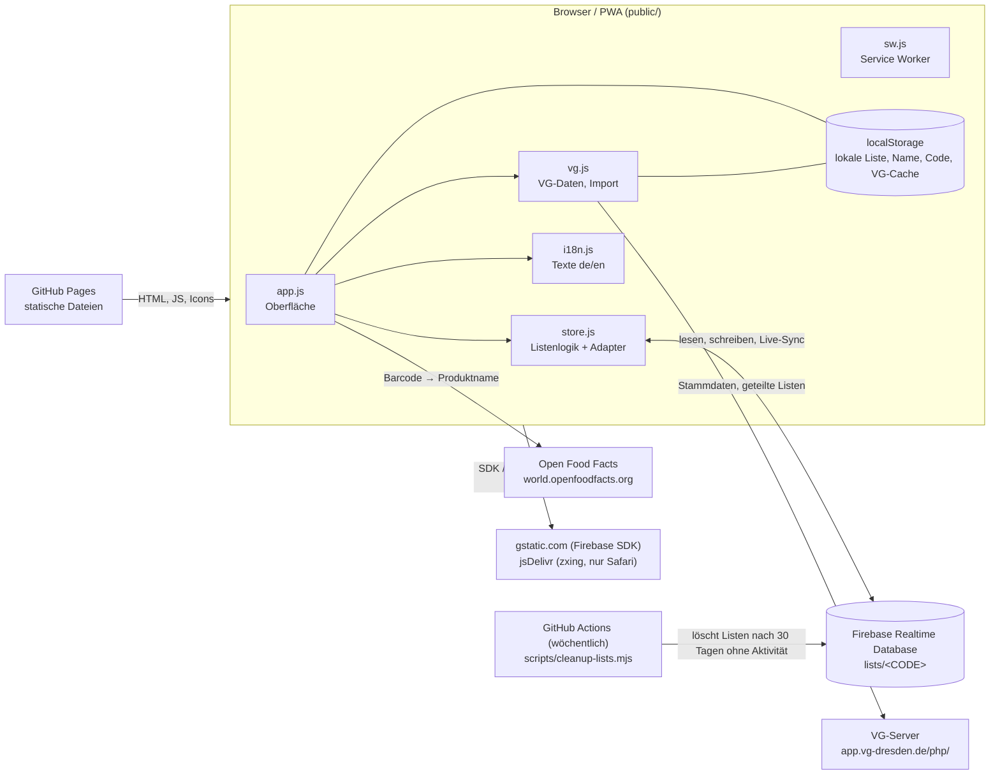

# Architektur

Stand: Beschreibung des Codes in `public/`, `database.rules.json`, `scripts/`, `.github/workflows/` und `test/`. Was sich aus dem Code nicht sicher ableiten lässt, ist mit **(unsicher)** markiert.

## Überblick

vg-korbjagd ist eine statische Seite ohne eigenen Server und ohne Build-Schritt: ES-Module, die der Browser direkt lädt. Die Liste liegt zuerst nur lokal im `localStorage` des Handys (Code `LOCAL`, ohne Namen, auch offline). Erst beim Teilen zieht sie in die Firebase Realtime Database um; dann abonnieren alle Geräte dieselbe Liste und sehen Änderungen sofort.



Alle Aufrufe an VG-Server, Open Food Facts und Firebase gehen direkt aus dem Browser. Die VG-Endpunkte erlauben das per CORS (siehe [vg-api.md](vg-api.md)). Das Projekt ist von der VG Dresden unabhängig.

Dateien in `public/`:

| Datei | Aufgabe |
|---|---|
| `index.html` | Gerüst und Styles (CSS-Variablen mit der VG-Dresden-Farbpalette, hell und dunkel), alle Ansichten (Namensabfrage, Liste, Leergut, Kasse, Rangliste) und Dialoge (Teilen, Zurücksetzen, Import, Scanner) |
| `app.js` | Oberfläche, Ereignisse, Scanner, Dialoge, Teilen und Beitreten |
| `store.js` | Datenschicht: Adapter (Firebase/lokal), Listenlogik, Aktivitätsstempel |
| `i18n.js` | alle sichtbaren Texte (Deutsch und Englisch), Spracherkennung, `t()` und `applyStatic()` |
| `legal-config.js` | Kontaktangabe für die Datenschutzseite |
| `privacy.html`, `docs/index.html` | Datenschutzhinweise und Hilfeseite, beide zweisprachig |
| `vg.js` | VG-Stammdaten laden und zwischenspeichern, Teilen-Links der Original-App entschlüsseln |
| `firebase-config.js` | Firebase-Webkonfiguration (öffentliche Kennungen); `null` = Demo-Modus |
| `sw.js`, `manifest.json`, `icon.svg`, `icons/` | PWA: Service Worker, Manifest, Icons |
| `vendor/qrcode.js`, `vendor/crypto-js.js` | eingebundene Fremdbibliotheken (QR-Code, AES) |

## Datenmodell in Firebase

Alles liegt unter `lists/<CODE>`. Die lokale Liste hat dieselbe Form, liegt aber im `localStorage` unter dem Code `LOCAL` (ohne `meta`, `scores` und `activity`). Der Code besteht aus 6 Zeichen aus `ABCDEFGHJKLMNPQRSTUVWXYZ23456789` (ohne I, O, 0, 1). `create()` würfelt so lange, bis `meta` noch nicht existiert.

```json
{
  "lists": {
    "K7M2QX": {
      "meta": { "created": 1761900000000 },
      "activity": 1761900300000,
      "items": {
        "k3j9x2ab": {
          "id": "k3j9x2ab",
          "title": "Vollmilchschokolade",
          "amount": 2,
          "unit": null,
          "info": null,
          "vgNum": 1234,
          "ean": null,
          "checked": true,
          "checkedBy": "🦊 Mia",
          "checkedAt": 1761900300000,
          "addedBy": "🐼 Paul",
          "addedAt": 1761900100000
        }
      },
      "scores": { "🦊 Mia": 3, "🐼 Paul": 0 },
      "deposit": {
        "7": { "🦊 Mia": 2, "🐼 Paul": 1 }
      }
    }
  }
}
```

(Beispielwerte erfunden.) Erläuterung:

- **Nutzerschlüssel:** `"<Emoji> <Name>"`, Zeichen `. $ # [ ] /` werden durch `_` ersetzt (`userKey`), weil Firebase sie in Schlüsseln verbietet. Es gibt keine Anmeldung: Wer denselben Emoji-Namen wählt, ist für die App dieselbe Person.
- **`items/<id>`:** `id` wird im Browser gewürfelt. Titel max. 120 Zeichen, `amount` 1–999, `unit` max. 20, `info` max. 200, `ean` nur 8–14 Ziffern, sonst `null`. Nicht abgehakt: `checked: false`, `checkedBy`/`checkedAt` `null`.
- **`scores/<Nutzerschlüssel>`:** Punktestand, nie unter 0. Eintrag wird beim Beitritt mit 0 angelegt (`join`).
- **`deposit/<Pfand-Typ-ID>/<Nutzerschlüssel>`:** Anzahl Leergut-Stücke, die diese Person eingetragen hat. Die Typ-ID (`id` aus `getDepositsList.php`) ist hier als Zeichenkette Schlüssel; die Namen der Typen kommen nicht aus Firebase, sondern aus den VG-Daten.
- **`activity`:** Zeitstempel (ms) der letzten Aktivität, wird von `store.js` geschrieben (siehe unten) und vom Aufräum-Job gelesen.
- **Regeln** (`database.rules.json`): Außerhalb von `lists/<CODE>` ist alles gesperrt; `$code` muss auf `^[A-Z0-9]{6}$` passen und ein `meta` enthalten. Lesen ist unter dem Code offen, wer ihn kennt, kann lesen. Schreiben auf Listenebene ist nur zum **Löschen** erlaubt (`!newData.exists()`), Anlegen und Ändern geht nur unterhalb: `meta` einmalig, `activity`, `items`, `scores` und `deposit` mit Feldprüfungen (Typen, Längen, Nutzerschlüssel-Muster, Zahlenbereiche, keine fremden Felder in `items` und `meta`). Die Prüfungen in `store.js` müssen dazu passen (`test/rules.test.js`). Sicherheitsfragen: siehe [security.md](security.md), Aufbewahrung: [retention.md](retention.md).

## `store.js`

### Adapter

Die Listenlogik (`createStore`) ist einmal geschrieben und läuft gegen einen Adapter mit fünf Funktionen: `subscribe`, `get`, `update` (Transaktion), `set`, `remove`.

- **`firebaseAdapter(cfg)`** lädt das Firebase-SDK (Version 10.14.1) zur Laufzeit von `gstatic.com`. `subscribe` meldet den Listenstand und über `.info/connected` den Verbindungsstatus (Chip „Offline“ in der Kopfzeile, nur bei geteilter Liste ohne Verbindung). `update` ist `runTransaction`.
- **`localAdapter(storage)`** speichert alles als JSON in `localStorage` (Schlüssel `korbjagd-local-db`) und benachrichtigt andere Tabs über das `storage`-Ereignis. Er trägt die lokale Liste (`LOCAL`), die immer so läuft. Exportiert `firebase-config.js` `null`, dient er zusätzlich als Ersatz für Firebase (Demo-Modus mit Hinweisbanner; geteilte Listen liegen dann ebenfalls im Browser), und in den Tests läuft er mit eigenem Storage-Objekt. Leere Knoten werden wie bei Firebase entfernt.

`update(code, path, fn)`: `fn` bekommt den alten Wert; Rückgabe `undefined` bricht ab (`committed: false`), `null` löscht, sonst wird der Wert geschrieben. Mehrere Geräte, die gleichzeitig dasselbe tun, erzeugen so nur eine Änderung.

### Punktelogik

Punkte werden in `scores` mitgeführt und bei jeder Aktion über `bump` angepasst (`Math.max(0, alt + Änderung)`, ebenfalls als Transaktion). Der Zähler wird nur erhöht, wenn die Haupt-Transaktion tatsächlich etwas geändert hat (`committed`). Deshalb gibt doppeltes Abhaken nur einen Punkt.

| Aktion | Wirkung auf Punkte |
|---|---|
| `add` | keine (gibt es schon eine Artikel-`id`, passiert nichts) |
| `check(…, true)` | +1 für den Abhaker |
| `check(…, false)` | −1 für den **ursprünglichen** Abhaker (`checkedBy`), nicht für den, der zurücknimmt |
| `setNum(…, checkToo)` | VG-Nummer nachtragen; wird der Artikel dadurch erstmals abgehakt, +1 für den Eintragenden. Der Titel wird nur ersetzt, wenn er noch der Platzhalter `VG-Nr. <Zahl>` ist |
| `remove` | war der Artikel abgehakt, −1 für den ursprünglichen Abhaker |
| `depositAdd` | +1 Stück für den Eintragenden, +1 Punkt |
| `depositRemove` | zieht erst ein eigenes Stück ab, hat die Person keins, eins vom größten Beitragenden; der Punkt geht bei dem ab, dessen Stück entfernt wurde |
| `clearChecked` | löscht abgehakte Artikel **ohne** Punktänderung |
| `clearAll` | löscht alle Artikel **ohne** Punktänderung |
| `clearDeposit` | löscht `deposit`, Punkte bleiben |
| `importList` | übernimmt Artikel (mit Abhak-Status) und Leergut der lokalen Liste in eine neue geteilte Liste, **ohne** Punkte; das Leergut wird je Pfand-Typ summiert und dem Teilenden zugeschrieben |
| `resetScores` | setzt alle Zähler auf 0 („Neue Runde“ im Rangliste-Reiter, mit Rückfrage) |

Das Zurücksetzen in der Oberfläche (Menü) ändert nie Punkte: Es ruft `clearChecked` oder `clearAll` und optional `clearDeposit` auf. Punkte ändert nur die Schaltfläche „Neue Runde“ im Reiter Rangliste: `resetScores` setzt alle Zähler auf 0 und rechnet nichts aus dem Korb oder dem Leergut zu. Nimmt später jemand einen alten Artikel wieder heraus, bleibt der Zähler bei 0 (er geht nie unter null).

### Aktivität, Löschen, Aufbewahrung

- **`activity`:** Die Funktionen `join`, `add`, `check`, `setNum`, `remove`, `depositAdd`, `depositRemove`, `clearDeposit`, `clearChecked`, `clearAll`, `resetScores`, `importList` sowie `create` schreiben `lists/<CODE>/activity`, höchstens einmal pro Stunde und Liste. Schlägt das Schreiben fehl (alte Regeln, offline), bleibt das folgenlos.
- **`deleteList`:** entfernt die ganze Liste für alle (`db.remove(code, '')`; die Regeln erlauben Schreiben auf Listenebene nur dafür).
- **Aufräum-Job:** `.github/workflows/cleanup.yml` läuft wöchentlich (montags 03:17 UTC) und manuell (mit Trockenlauf); `scripts/cleanup-lists.mjs` löscht per Dienstkonto Listen, deren letzte Aktivität (oder Erstellung) älter als 30 Tage ist. Fehlt das Secret `FIREBASE_SERVICE_ACCOUNT`, schlägt der Workflow absichtlich fehl. Einzelheiten: [retention.md](retention.md).
- Verschwindet eine geteilte Liste (gelöscht von jemandem oder vom Job), merkt das der Abonnent in `onSnapshot` (kein `meta` mehr), zeigt einen Hinweis und fällt auf die lokale Liste zurück.

### Gleichstand

Die Rangliste (`render` in `app.js`; Reiter nur auf geteilten Listen) sortiert nach Punkten absteigend. Der Platz ist `1 + Index des ersten Eintrags mit gleicher Punktzahl`, also 1, 1, 3, … bei Gleichstand. Medaillen 🥇🥈🥉 gibt es nur für Plätze 1–3 und nur mit mehr als 0 Punkten; das Podest zeigt Platz 2, 1, 3 in dieser Reihenfolge, auch mehrere Personen pro Platz.

## `vg.js`

- **Quelle:** `https://app.vg-dresden.de/php/`, Endpunkte siehe [vg-api.md](vg-api.md). Jede Anfrage hat 20 s Zeitlimit.
- **Cache mit Prüfsummen (`loadVg`):** Zuerst `getChecksums.php`. Stimmen die Prüfsummen mit dem Cache (`localStorage`, Schlüssel `korbjagd-vg-v2`) überein oder ist das Netz weg, wird der Cache benutzt. Sonst werden Produkte, Hersteller, Länder, Einheiten und Pfand-Typen komplett neu geladen und gespeichert (alles oder nichts, nicht je Tabelle). Schlägt das Laden fehl, bleibt der alte Cache; ohne Cache und ohne Netz ist das Ergebnis `null`, und die App läuft ohne VG-Hilfen weiter.
- **Index (`buildIndex`):** Suche nach Nummer (`lookup`), Nummernanfang (`searchByNumber`, bis 6 Treffer, genaue Nummer zuerst, sonst aufsteigend), exaktem Titel (`byTitle`) und Wörtern im Titel (`search`, bis 8 Treffer). Titel werden von Trennstrichen der Quelldaten bereinigt (`cleanTitle`: „Voll- milchschokolade“ → „Vollmilchschokolade“). `infoText` bildet aus Einheit, Hersteller, Land und „regional“ eine Infozeile. Außerdem enthält der Index die Pfand-Typen (`deposits`).
- **Import aus der VG-App:** `parseShareLink` erkennt `…shareId=<ID>#<SCHLÜSSEL>`. `fetchSharedList` holt per POST den verschlüsselten Text, `decryptShared` entschlüsselt ihn mit CryptoJS-AES (Passphrase = Schlüssel aus dem Link, der den Browser nie verlässt) und liefert Titel, VG-Nummer, Menge, Einheit und Abhak-Status. `app.js` lädt `vendor/crypto-js.js` erst beim ersten Import nach. Importiert wird nur, was nicht schon (gleicher Titel, Groß-/Kleinschreibung egal) auf der Liste steht; alle Artikel kommen **nicht abgehakt** hinein, der Abhak-Status aus der VG-App wird ignoriert. Der Import-Dialog öffnet sich über das Menü oder durch Einfügen eines Teilen-Links ins Eingabefeld.

## `app.js`

Zustand: `state = { items, scores, deposit }`, bei jedem Ereignis des Adapters komplett ersetzt und neu gerendert. `code` ist zunächst `LOCAL`; `store` zeigt dann auf den lokalen Store (`localStore`), nach dem Teilen oder Beitreten auf den Firebase-Store (`remoteStore`). Im `localStorage` liegen `me` (Name, Emoji), `code` (zuletzt benutzte geteilte Liste), `numMode` und die lokale Liste selbst. Der Code einer geteilten Liste kann auch per `?list=<CODE>` in der URL kommen. Alle Texte kommen aus `i18n.js` (`t('schlüssel')`); die Sprache folgt dem System (Deutsch, sonst Englisch, `?lang=de|en` überschreibt).

- **Start (`init`):** Es gibt keinen Willkommensbildschirm. Mit `?list=<CODE>` (anders als der gespeicherte Code) wird beigetreten (`joinShared`); mit gespeichertem Code und Namen startet direkt die geteilte Liste (`startShared`); sonst startet die lokale Liste (`startLocal`). Name und Emoji werden erst beim Teilen oder Beitreten abgefragt (`askIdentity`, Ansicht „Wer bist du?“).
- **Kopfzeile:** Kein Titel, sondern der Korbzähler „🛒 erledigt/alle“, daneben bei geteilter Liste und fehlender Verbindung das orange Chip „Offline“ (erst nach 3 Sekunden, sonst blitzt es bei jedem Start kurz auf). Icon-Knöpfe: Teilen und „⋯“ (Menü mit Liste zurücksetzen, Liste importieren, Liste verlassen (nur geteilt), Hilfe und Datenschutz).
- **Teilen (Dialog auf der lokalen Liste):** „Liste teilen“ (`shareLocalList`): fragt bei Bedarf Name und Emoji, legt eine neue Liste an (`create`), lädt Artikel und Leergut per `importList` hoch (keine Punkte für vorhandene Artikel), löscht erst danach die lokale Kopie, wechselt auf die geteilte Liste und öffnet deren Teilen-Dialog. Schlägt das fehl, bleibt die lokale Liste unverändert. Im selben Dialog steht ein Feld zum Beitreten per 6-stelligem Code (`joinShared`: prüft `exists`, sonst Hinweis „Diese Liste gibt es nicht“ bzw. „Keine Verbindung zur Datenbank“ und zurück zur lokalen Liste).
- **Teilen (Dialog auf einer geteilten Liste):** QR-Code (`vendor/qrcode.js`) mit `?list=<CODE>`, der Code, „Link senden“ (Web-Share, sonst Zwischenablage) und „Liste für alle löschen“ (`deleteList`, mit Rückfrage; danach zurück auf die lokale Liste).
- **Zurücksetzen (Dialog):** Wahl „Nur erledigte Artikel“ (Standard) oder „Alle Artikel“ (`clearChecked` / `clearAll`, „alle“ mit Rückfrage), dazu das Häkchen „Auch Leergut leeren“ (`clearDeposit`, Standard an). Auf einer geteilten Liste gilt das für alle (fetter Hinweis im Dialog). „Liste verlassen“ und „Liste importieren“ sind eigene Menüeinträge, nicht Teil des Dialogs: Verlassen führt zurück auf eine leere lokale Liste, die geteilte bleibt für die anderen unverändert. Punkte ändert das Zurücksetzen nie.
- **Hinweise:** Auf geteilten Listen erscheint eine kurze Einblendung mit Emoji und Name, wenn ein anderer etwas abhakt oder hinzufügt. Die Abhaker-Marke an Artikeln gibt es nur dort.
- **Reiter Liste:** Eingabefeld (Text oder reine Zahl = VG-Nummer; „123“-Schalter für Zifferneingabe), Scanner (Barcode-Symbol), offene Artikel, darunter „Im Korb“. Bei Namen erscheint ab 2 Buchstaben ebenfalls eine antippbare Liste ohne Nummern (`searchNames`): Produkte mit gleichem Namen erscheinen nur einmal, Antippen legt den Artikel sofort an, immer ohne VG-Nummer (die lässt sich in der Liste nachtragen oder ändern: kleine Nummer unter dem Artikel antippen, leeres Feld entfernt sie). Platzhalter wie „unbesetzt …“ und „RESERVIERT …“ (etwa ein Fünftel der VG-Liste) werden nie vorgeschlagen (`vg.js`); eine vollständig getippte Platzhalter-Nummer wird trotzdem angenommen, der Artikel heißt dann wie der Eintrag. Bei reinen Zahlen erscheint ab 3 Ziffern eine antippbare Liste passender Produkte (`searchByNumber`); Antippen legt das Produkt sofort an; ab 4 Ziffern ohne Treffer steht ein Hinweis. Artikel ohne Nummer haben ein kleines Nummernfeld; Nummer eintragen legt den Artikel zugleich in den Korb. Ein eingefügter Teilen-Link der VG-App öffnet den Import.
- **Scanner:** Chrome/Android über den eingebauten `BarcodeDetector`, sonst zxing von jsDelivr (`@zxing/library@0.21.3`). Bekannte EAN → Artikel wird abgehakt; unbekannte EAN → Produktname von Open Food Facts (`product_name_de`, sonst `product_name`, plus erste Marke), danach Suche nach gleichem Titel, sonst neuer Artikel; dann abhaken. Ohne Treffer heißt er „Artikel <EAN>“ (englisch „Item <EAN>“). Manuelle Codeeingabe ist möglich.
- **Reiter Leergut:** Eine Zeile je Pfand-Typ aus den VG-Daten mit −/+ und Summe. Ohne geladene VG-Daten steht dort „VG-Daten werden geladen …“.
- **Reiter Kasse:** Nur abgehakte Artikel **mit VG-Nummer**, nach Titel sortiert in Gruppen: „Artikel“ (VG-Nr. ≥ 1000), „Backwaren“ (VG-Nr. < 1000, getrennt) und „Leergut“ (Typen mit Stückzahl > 0). Antippen streicht eine Zeile durch und schiebt sie in den Block „Erledigt“ ganz unten (unter das Leergut); noch einmal antippen holt sie zurück. Das gilt nur auf diesem Handy und nur bis zum Neuladen (`checkoutDone` liegt im Speicher, wird nicht gesynct). In diesem Reiter fordert die App einen Bildschirm-Wachhalter (`wakeLock`) an. Dass Nummern unter 1000 Backwaren sind, ist eine Annahme im Code, keine Angabe aus der VG-Doku **(unsicher)**.
- **Reiter Rangliste:** Nur auf geteilten Listen; auf der lokalen Liste ist der Reiter ausgeblendet. Podest und Liste, keine Schaltfläche zum Zurücksetzen der Punkte.

## Offline-Verhalten

Ist-Zustand laut Code.

- **Lokale Liste:** Liegt im `localStorage` und funktioniert vollständig offline (Hinzufügen, Abhaken, Leergut, Kasse, Zurücksetzen). Es gibt keinen Willkommensbildschirm mehr, der ohne Netz im Weg stünde.
- **Service Worker (`sw.js`, Cache `korbjagd-v4`):** Beim Installieren werden `./`, `index.html`, `app.js`, `store.js`, `vg.js`, `i18n.js`, `legal-config.js`, `privacy.html`, `docs/index.html`, `firebase-config.js`, `manifest.json`, `icon.svg`, die Icons und `vendor/qrcode.js` / `vendor/crypto-js.js` in den Cache gelegt. Für gleiche-Herkunft-GET-Anfragen gilt: erst Netz (und Antwort in den Cache), bei Fehler aus dem Cache; Navigationen fallen auf `index.html` zurück. Anfragen an Firebase, gstatic, VG-Server usw. gehen am Service Worker vorbei.
- **Firebase-SDK** kommt von `gstatic.com` und ist damit offline nur verfügbar, wenn der Browser es selbst noch zwischengespeichert hat **(unsicher)**. Es wird erst geladen, wenn eine geteilte Liste gebraucht wird (`getRemote()` in `app.js`): Die lokale Liste startet daher immer ohne Netz. Scheitert das Laden beim Teilen oder Beitreten, kommt „Keine Verbindung zur Datenbank.“ und die lokale Liste bleibt unverändert; ein gespeicherter Code einer geteilten Liste bleibt erhalten und wird beim nächsten Start erneut versucht (so geprüft mit einer absichtlich fehlschlagenden SDK-Adresse).
- **App-Start mit gespeicherter geteilter Liste:** Sie startet direkt (`startShared`), es gibt keine Vorabprüfung; Firebase liefert, was es lokal hat. Beitreten (`?list=` oder Code) prüft vorher `exists` und meldet ohne Netz „Keine Verbindung zur Datenbank.“; dann bleibt man auf der lokalen Liste.
- **Verbindung weg bei laufender App:** Nach 3 Sekunden erscheint in der Kopfzeile das Chip „Offline“, bei Wiederverbindung verschwindet es. Schreibaktionen werden vom Firebase-SDK zwischengespeichert und nach der Wiederverbindung gesendet; ob das über ein Neuladen hinweg hält, ist nicht konfiguriert, vermutlich nicht **(unsicher)**. Der lokale Zustand zeigt die eigenen Änderungen sofort. Transaktionen (Abhaken) laufen offline gegen den lokal bekannten Stand und werden beim Verbinden bestätigt; schlägt das dort fehl, korrigiert sich die Anzeige **(unsicher, aus Firebase-Verhalten abgeleitet, nicht getestet)**. Teilen (`shareLocalList`) braucht Netz; bei Fehler bleibt die lokale Liste erhalten.
- **VG-Daten** kommen offline aus dem `localStorage`-Cache, falls schon einmal geladen. Import aus der VG-App und Open Food Facts brauchen Netz (Fehlermeldung bzw. „Artikel <EAN>“ als Name).

## Tests

`npm test` führt `node --test` aus (Node ≥ 18, keine Abhängigkeiten); aktuell 36 Tests in fünf Dateien.

- `test/store.test.js`: Listenlogik gegen den lokalen Adapter mit eigenem Storage: Anlegen/Existenz, Punkte beim Abhaken und Zurücknehmen, Idempotenz von `add`/`check`, Löschen, `clearChecked` und `clearAll` (Punkte und Leergut bleiben), `resetScores`, EAN- und Nutzerschlüssel-Prüfung, Leergut-Punkte, Eingabevalidierung, `importList` (Übernahme der lokalen Liste ohne Punkte, kaputte Einträge werden ignoriert), Aktivitätsstempel (höchstens stündlich), `deleteList`.
- `test/rules.test.js`: eine kleine Auswertung von `database.rules.json` im Test: Struktur (Lesen offen, Schreiben auf Listenebene nur zum Löschen), gültige Dokumente aus `store.js` werden akzeptiert, Müll wird abgelehnt, der normale Ablauf von `store.js` schreibt nur Erlaubtes.
- `test/vg.test.js`: `cleanTitle`, Index (Nummer, Titel, Suche, Infotext), Erkennen und Entschlüsseln von Teilen-Links, Pfand-Typen im Index.
- `test/i18n.test.js`: Spracherkennung (`?lang`, Fallback Englisch), `t()` mit Parametern, gleiche Schlüssel und Platzhalter in Deutsch und Englisch, alle in `app.js` und in der Tabelle der statischen Texte benutzten Schlüssel existieren, die Selektoren der statischen Texte sind exakt.
- `test/cleanup.test.js`: `scripts/cleanup-lists.mjs`: Auswahl abgelaufener Listen (`selectExpired`, `lastActivity`), das 30-Tage-Limit (29 Tage bleibt, 31 Tage wird gelöscht), JWT-Signatur für das Dienstkonto, `dbUrl` (`.json` vor der Query).

Nicht getestet: die Oberfläche (`app.js`), der Firebase-Adapter, der Service Worker, die Netzwerkaufrufe in `vg.js` und im Aufräum-Skript.

## Deployment

`.github/workflows/pages.yml` läuft bei Push auf `main` (und manuell): Checkout, `node --test`, dann wird der Ordner `public/` als Pages-Artefakt hochgeladen und veröffentlicht. Schlägt ein Test fehl, wird nicht veröffentlicht. Es gibt keinen Build-Schritt. Daneben gibt es `checks.yml` (dieselben Prüfungen wie lokal per prek, dazu gitleaks über die Historie) und `cleanup.yml` (siehe oben). Die Datenbankregeln werden nicht mitveröffentlicht, sondern von Hand in der Firebase-Konsole eingespielt. Lokal: `npm start` (Python-Webserver auf Port 3000); ohne Firebase-Konfiguration im Demo-Modus.
